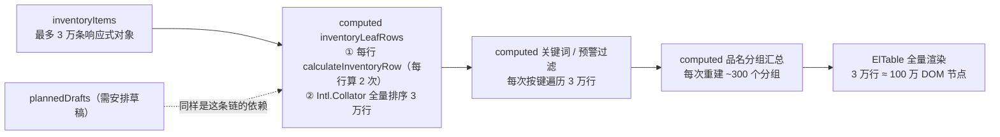
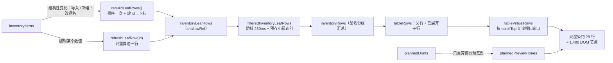

# 主面板大数据量性能优化（3 万行级）

本文记录主面板从「ElTable 全量渲染」改造到「增量计算 + 滚动虚拟化」的完整方案：优化前的瓶颈、总体思路、每项改造的做法与代码位置、优化前后的实测数据、以及后续还能做什么。

- 适用范围：主面板 `/`（含示例面板 `/example`，两者共用 `InventoryPanelView.vue`）
- 业务量级：Excel 单次导入 1 万 ~ 3 万+ 行（品名 × 颜色 = SKU）
- 判定口径：以生产构建（`npm run build` + `vite preview`）在 Chromium 中的实测为准
- 最后更新：2026-11-01（对应「Excel 导入 + 3 万行性能改造」迭代）

---

## 1. 结论先行

| 指标（30,000 行） | 优化前 | 优化后 | 变化 |
|---|---|---|---|
| 选文件 → 确认 → 界面可用 | **33.2 s** | **1.55 s** | 约 **21×** 更快 |
| 解析 + 预览弹窗 | 1.82 s | 0.65 s | 约 2.8× 更快 |
| 表格 DOM 节点 | **1,030,816** | **1,373** | 约 **750×** 更少 |
| JS 堆内存 | **2.29 GB** | 52 ~ 130 MB | 约 **17×** 更低 |
| 点一次预警筛选 | **> 60 s 无响应** | ~70 ms | 可用 |
| 大跨度滚动跳转 | 卡死 | 110 ~ 150 ms | 可用 |
| 编辑一个数值 | 3 万行全量重算 | 只重算该行 + 父行 | 定性改善 |

原有业务口径、计算关系、交互（展开折叠、需安排草稿/采纳/撤销、紧急补货、采购清单、Excel 导出）全部保持不变。

---

## 2. 优化前：架构与瓶颈

### 2.1 数据链路



三个特征决定了它必然扛不住大数据：

1. **渲染与数据量线性绑定**：ElTable（含 `tree-props`）会把所有行都渲染成 DOM，即使分组折叠，子行节点依然存在。
2. **计算与数据量线性绑定**：任何一次数据变化（哪怕只是 `plannedDrafts` 里改一个字符）都会重跑 `map + 排序 + 过滤 + 分组`。
3. **重复计算**：每行除了正常计算，还要再跑一次 `calculateInventoryRow` 求“需安排草稿的预览色”。

### 2.2 实测（优化前，含两次权宜优化）

| 行数 | 解析 + 弹窗 | 确认 → 可用 | 表格 DOM 节点 | JS 堆 | 筛选 |
|---|---|---|---|---|---|
| 5,000 | 0.57 s | 6.0 s | 174,816 | — | 数秒 |
| 10,000 | 0.72 s | 11.8 s | 346,616 | — | 明显卡顿 |
| 30,000 | 1.82 s | **33.2 s** | **1,030,816** | **2.29 GB** | **>60 s 超时** |

> 这里的“优化前”已包含上一轮的两个权宜优化（导入超过 200 行自动收起、未展开行只渲染文本）。可见问题根因在渲染架构，权宜手段收效有限。

### 2.3 瓶颈归因

| # | 瓶颈 | 说明 |
|---|---|---|
| 1 | ElTable 全量渲染 | 每行约 34 个 DOM 节点，3 万行 = 100 万节点、2.3 GB 堆，接近浏览器崩溃线 |
| 2 | 全量重算 | `inventoryLeafRows` 是 computed，`plannedDrafts` / `inventoryItems` 任一变动都重跑整表 |
| 3 | 重复计算 | 每行额外跑一次 `calculateInventoryRow`（只为草稿预览色），计算量翻倍 |
| 4 | 排序成本 | `Intl.Collator` 对 3 万行做全排序（约 45 万次比较），且每次重算都执行 |
| 5 | 无防抖、无索引 | 搜索框逐键全量过滤；预警计数 4 次全表遍历；`inventoryItems.find(id)` 是 O(n) |
| 6 | 导出与解析 | 解析在主线程（约 1.8 s 白屏）；导出用字符串拼接 3 万行 |

---

## 3. 总体思路

四条原则，按优先级从上到下：

1. **渲染窗口化**：DOM 数量只与「视口高度」有关，与「数据量」无关。
2. **计算增量化**：工作量与「本次变更的行数」成正比，而不是与总行数成正比。
3. **输入与派生解耦**：可编辑的草稿状态不进入主计算链，避免“打字即全表重算”。
4. **IO 前置校验**：解析只解压必要部件、表头自动定位、错误行集中反馈，不合规数据不进状态。



---

## 4. 优化明细

### 4.1 计算层：从「全量重算」到「单行增量」

**A1. 单行缓存 + 增量刷新**（`src/views/InventoryPanelView.vue`）

`inventoryLeafRows` 由 computed 改成 `shallowRef`，只保留两个写入口：

```js
const inventoryLeafRows = shallowRef([])
const leafRowIndexById = new Map()

// 结构性变化（导入、改品名）才重建：排序一次 + 建立 id→下标
function rebuildLeafRows() {
  const rows = inventoryItems.map(buildLeafRow).sort(compareLeafRows)
  leafRowIndexById.clear()
  rows.forEach((row, index) => leafRowIndexById.set(row.id, index))
  inventoryLeafRows.value = rows
}

// 编辑某个数值：只替换这一行（切片是 3 万个指针，约 0.2ms）
function refreshLeafRow(id) {
  const index = leafRowIndexById.get(id)
  const item = itemById.value.get(id)
  if (index === undefined || !item) return
  const rows = inventoryLeafRows.value.slice()
  rows[index] = buildLeafRow(item)
  inventoryLeafRows.value = rows
}
```

调用点：`updateValue`、`acceptPlannedDraft`、`undoPlannedAcceptance`、`submitUrgentPlans` 走 `refreshLeafRow`；`applyImportedItems`、`commitProduct` 走 `rebuildLeafRows`。行数变化另有 `watch(() => inventoryItems.length, rebuildLeafRows)` 兜底。

**A2. 消除重复计算**

原来每行要算两次 `calculateInventoryRow`（一次正常值、一次草稿值求预览色）。现在：

- 正常值只在 `buildLeafRow` 里算一次；
- 草稿预览色只在**真的输入了草稿**的那一行算一次，结果放进独立的 `plannedPreviewTones`：

```js
function updatePlannedDraft(id, value) {
  if (Reflect.has(plannedUndoHistory, id)) return
  plannedDrafts[id] = value
  refreshPlannedPreviewTone(itemById.value.get(id))
}

function getPlannedTone(row) {
  if (!Reflect.has(plannedDrafts, row.id)) return row.urgencyTone
  return plannedPreviewTones[row.id] ?? row.urgencyTone
}
```

**A3. 行状态外移**

行对象不再带 `hasPlannedDraft / hasPlannedUndo / plannedDraft / plannedPreviewTone` 这些易过期字段，改成模板里按需读取的函数（`hasPlannedDraft(id)`、`hasPlannedUndo(id)`、`getPlannedDraft(row)`）。好处是：草稿/撤销状态变化时只有相关单元格重新渲染，行缓存不会失效。

**A4. 筛选：防抖 + 索引 + 单遍计数**

```js
// 输入防抖 250ms；清空时立即生效，保证“重置”无延迟
watch([productFilter, colorFilter], () => {
  if (filterDebounceTimer) clearTimeout(filterDebounceTimer)
  if (!productFilter.value.trim() && !colorFilter.value.trim()) return applyKeywordFilters()
  filterDebounceTimer = window.setTimeout(applyKeywordFilters, 250)
})
```

- 行对象在构建时就预存 `searchProduct / searchColor`（小写），过滤时只做 `includes`，不再逐行 `toLocaleLowerCase`；
- 无筛选条件时直接返回原数组引用，避免无谓复制；
- 预警计数改为一次遍历：

```js
for (const row of inventoryLeafRows.value) {
  counts.all += 1
  if (row.urgencyTone in counts) counts[row.urgencyTone] += 1
}
```

**A5. O(1) 索引**

新增 `itemById`（`Map<id, item>`），替换 `inventoryItems.find(...)`；导入时的需安排/撤销/采购清单迁移也全部走 `Map`（上一轮已改）。

### 4.2 渲染层：自研滚动虚拟化

**B1. 只渲染视口内的行**

固定行高 `TABLE_ROW_HEIGHT = 34`，上下各预留 `TABLE_OVERSCAN = 8` 行缓冲：

```js
const tableVirtualRows = computed(() => {
  const rows = tableRows.value
  const total = rows.length
  if (total === 0) return { rows: [], offset: 0, total: 0 }

  const start = Math.max(0, Math.floor(tableScrollTop.value / TABLE_ROW_HEIGHT) - TABLE_OVERSCAN)
  const count = Math.ceil(tableViewportHeight.value / TABLE_ROW_HEIGHT) + TABLE_OVERSCAN * 2
  const end = Math.min(total, start + count)
  return { rows: rows.slice(start, end), offset: start * TABLE_ROW_HEIGHT, total }
})
```

配套：

- `tableBodyHeight = total × 行高` 作为占位高度，滚动条长度与真实行数一致；
- 可见行用 `transform: translateY(offset)` 定位，滚动时只替换渲染集合；
- 滚动事件用 `requestAnimationFrame` 合并，一帧最多更新一次；
- 视口高度用 `ResizeObserver` 跟随容器变化。

**B2. 表头与内容同容器滚动**

表头放在同一个滚动容器里 `position: sticky; top: 0`：纵向固定、横向随内容走，天然避免“表头与内容不同步”这个虚拟表格的老问题。

**B3. 两级分组表头 + 列网格**

- 列定义数据驱动：`TABLE_COLUMNS`（key / label / width / group），派生 `tableGridTemplate`（每列 `minmax(宽度px, 宽度fr)`，剩余空间按列宽比例分摊，不设空白填充列）与 `tableColumnGroups`（商品 / 入口 / 出口 / 库存 / 数据反馈 的合并跨度）；
- 表头两行：分组行按 `grid-column: span N` 合并，列名行逐列；
- 画布宽度 `width: max(100%, 总列宽)`：宽屏铺满、窄屏横向滚动，不留空白列。

**B4. 为什么没有直接用 `el-table-v2`**

调研结论（Element Plus 2.14）：

| 需求 | `el-table-v2` 支持情况 |
|---|---|
| 两级分组表头（商品/入口/出口/库存/数据反馈） | ❌ 不支持，`columns` 是扁平定义 |
| 单元格保留模板写法 | ❌ 只能写渲染函数；`#cell` 插槽的 `h()` 产物拿不到本组件 `scopeId`，`<style scoped>` 失效 |
| 固定行高 + 横向滚动 + 行样式/行点击 | ✅ |

因为要保留两级表头与现有模板/样式结构，最终采用「同样思路、自己实现」的窗口化方案：行为等价，模板可读性与样式作用域都不受影响。

**B5. 页面布局**

主面板从“整页滚动”改为 `height: 100vh` 的 flex 纵向布局：导航 + 工具栏 + 筛选固定在顶部，表格占满剩余高度并在内部滚动（`flex: 1; min-height: 0; overflow: auto`）。

### 4.3 配置信息页兜底

配置页（`src/views/ConfigView.vue`）仍是常规 ElTable（每行两个 ElSelect 的维护场景），无法直接套虚拟滚动，改为按规模分档：

| 记录数 | 渲染方式 |
|---|---|
| ≤ 500 | 保持按品名分组的树形展示（与原行为一致，不显示分页） |
| > 500 | 切换为扁平表格 + 分页，每页 60 行 |

实测 3 万行：进入配置页 1.56 s、翻页 1.27 s（优化前分别是 6.2 s / 5.2 s）。

### 4.4 导入链路（上一轮实现，本次未改口径）

| 项 | 做法 |
|---|---|
| 解析 | `fflate.unzipSync` 加 `filter`，只解压 `workbook.xml` / `rels` / `sharedStrings.xml` / 目标工作表，跳过样式与图片 |
| 表头 | 前 10 行内自动定位同时含“品名”“颜色”的行，兼容“保存 Excel”导出的两行分组表头 |
| 校验 | 品名/颜色必填、品名+颜色唯一、数值列合法性、备货类型与色彩枚举；错误行带行号集中返回，不静默丢弃 |
| 落库 | 整表替换；需安排、撤销快照、本次采购清单按“品名 + 颜色”保留 |
| 提示 | 预览弹窗显示有效行数、空行数、错误行、被忽略的“需安排”列行数 |

Node 侧解析基准（30,000 行、1.27 MB）：**读表 307 ms + 映射校验 33 ms**——解析不是瓶颈，瓶颈始终在浏览器渲染。

---

## 5. 优化后实测

### 5.1 端到端

| 指标（30,000 行） | 优化前 | 优化后 |
|---|---|---|
| 解析 + 预览弹窗 | 1.82 s | 0.65 s |
| 确认 → 界面可用（含首屏渲染） | 33.2 s | 1.55 s |
| 表格 DOM 节点 | 1,030,816 | 1,373 |
| JS 堆（导入后） | 2.29 GB | 52 ~ 130 MB |
| 渲染行数 | 30,300 | 28（视口 + 缓冲） |

### 5.2 交互时延

| 操作 | 实测 | 说明 |
|---|---|---|
| 切换预警筛选（3 万行） | ~70 ms | 过滤 + 分组 + 重渲染 |
| 关键词筛选 | 防抖 250 ms 后 ~70 ms | 输入停顿即出结果 |
| 大跨度滚动跳转 | 110 ~ 150 ms | 含两次 rAF 等待（约 33 ms） |
| 编辑“生产中”数值 | 40 ~ 70 ms/键 | 同上，实际同步工作约 15 ~ 35 ms |
| 输入“需安排”草稿 | 20 ~ 35 ms/键 | 只更新该行预览色，实际约 5 ~ 10 ms |
| 展开 / 折叠品名 | 一帧内 | 只增减渲染集合 |
| 导出 Excel（3 万行） | ~1.4 s，生成 3.06 MB | 一次性生成，非交互路径 |

> 测量口径：`performance.now()` 到“连续两次 `requestAnimationFrame`”的时间，天然包含约 33 ms 的帧等待，因此表中数字是**上限**；浏览器窗口处于后台时 rAF 会被节流，测量前需先把页面切到前台。

### 5.3 其他页面

| 场景 | 优化前 | 优化后 |
|---|---|---|
| 进入配置信息（3 万行） | 6.2 s | 1.56 s |
| 配置信息翻页 | 5.2 s | 1.27 s |
| 切换示例面板 | 正常 | 正常（无导入入口，数据隔离不变） |

---

## 6. 关键实现片段

**扩展键 Set 化**：`expandedProductKeys` 每次派生为 Set，扁平化时 O(1) 判断：

```js
const expandedProductKeySet = computed(() => new Set(expandedProductKeys.value))
```

**扁平化（虚拟滚动的数据基础）**：只把“父行 + 已展开子行”放进渲染序列，折叠的品名不占用窗口：

```js
const tableRows = computed(() => {
  const expanded = expandedProductKeySet.value
  const rows = []
  for (const group of inventoryRows.value) {
    rows.push(group)
    if (!expanded.has(group.id)) continue
    for (const child of group.children) rows.push(child)
  }
  return rows
})
```

**滚动合并**：一帧只取一次 `scrollTop`，避免滚动事件风暴：

```js
function handleTableScroll() {
  if (tableScrollFrame) return
  tableScrollFrame = requestAnimationFrame(() => {
    tableScrollFrame = 0
    tableScrollTop.value = tableScrollRef.value?.scrollTop ?? 0
  })
}
```

**样式要点**（`<style scoped>`）：

```css
.inventory-vtable { flex: 1; min-height: 0; overflow: auto; }          /* 表格自己滚动 */
.inventory-vtable__head { position: sticky; top: 0; z-index: 3; }      /* 表头吸顶且随横向滚动 */
.inventory-vtable__rows { position: absolute; top: 0; right: 0; left: 0; }
.inventory-vtable__row { display: grid; border-bottom: 1px solid var(--industrial-grid); }
```

---

## 7. 正确性保障

改造不改变任何业务口径，因此用“逐项回归 + 数值对照”验证：

| 回归项 | 验证方式 | 结果 |
|---|---|---|
| 导入（1k / 30k） | 有效行数、跳过行数、预警分档合计 = 总数 | 通过（1914+6547+4040+17499 = 30000） |
| 需安排草稿 → 预览色 | 输入后单元格 tone 类变化 | 通过（如 2000 → `planned-cell--purple`） |
| 采纳 / 撤销 / 锁定 | 理论库存、按钮状态、采购清单条数 | 通过 |
| 编辑数值 → 派生列 | 生产中 435→535，在途 435→535、理论 1531→1631、父行汇总 +100 | 通过 |
| 展开 / 折叠 | 占位高度 3,604px ↔ 2,584px 往返 | 通过 |
| 行选中 / 点击品名 caret | 选中高亮；caret 切换展开 | 通过 |
| 筛选（预警 / 关键词 / 重置） | 行数与“全部”计数一致 | 通过 |
| 导出 Excel | 生成 3.06 MB、提示成功 | 通过 |
| 示例面板隔离 | 无导入入口、数据与主面板互不影响 | 通过 |
| 控制台 | 无 error / warning | 通过 |
| 构建 | `npm run build` 通过、`problems` 无告警 | 通过 |

---

## 8. 已知边界与后续路线

| # | 现状 | 建议 |
|---|---|---|
| 1 | 紧急补货弹窗在 1,914 条紧急行时打开约 2.5 s（未虚拟化，约 2.7 万节点） | 复用同一套滚动虚拟化；或改为“按品名聚合 + 展开填写” |
| 2 | 编辑数值仍会触发一次 3 万行的过滤/分组遍历（15 ~ 35 ms/键） | 把分组汇总改为“单组分增量更新”，可再降一个数量级 |
| 3 | 解析在主线程（3 万行约 0.6 s 占主线程） | 搬进 Web Worker，配进度条；写入分帧（每帧 2k 行） |
| 4 | 数据只在内存，刷新即回预设 | IndexedDB 分块持久化，或后端化 |
| 5 | 10 万行以上仍是前端硬扛 | 超过约 5 万行建议后端入库 + 接口分页（前端每次只取 200 行 + 服务端聚合） |

---

## 9. 文件与常量清单

| 文件 | 职责 | 关键常量 / 函数 |
|---|---|---|
| `src/views/InventoryPanelView.vue` | 主面板：派生数据、虚拟滚动、交互、导入导出 | `TABLE_ROW_HEIGHT=44`、`TABLE_OVERSCAN=8`、`TABLE_COLUMNS`、`rebuildLeafRows()`、`refreshLeafRow()`、`tableVirtualRows` |
| `src/views/ConfigView.vue` | 配置信息：分组树形 / 扁平分页 | `CONFIG_FLAT_LIMIT=500`、`CONFIG_FLAT_PAGE_SIZE=60`、`CONFIG_PAGE_ROW_BUDGET=300` |
| `src/utils/inventory.js` | 单行计算与格式化（口径来源） | `calculateInventoryRow()` |
| `src/utils/productGroups.js` | 品名父行汇总 | `groupRowsByProduct()` |
| `src/utils/xlsxSheet.js` | XLSX 读取（只解压必要部件） | `readWorkbookRows()` |
| `src/utils/inventoryImport.js` | 导入模板列、表头识别、校验 | `IMPORT_TEMPLATE_COLUMNS`、`parseInventorySheet()` |

---

## 10. 如何复现本文数据

1. 构建并以预览方式启动：`npm run build` → `npm run preview`。
2. 打开主面板，点击「导入Excel」，选择压测文件：
   - [库存导入测试-1000行.xlsx](../测试数据/库存导入测试-1000行.xlsx)
   - [库存导入测试-30000行.xlsx](../测试数据/库存导入测试-30000行.xlsx)
3. 关键观测点：
   - 控制台执行 `document.querySelectorAll('.inventory-vtable *').length` 看 DOM 节点数（应稳定在千级，与行数无关）；
   - `performance.memory.usedJSHeapSize` 看堆占用；
   - 用第 5 节的口径（`performance.now()` → 两次 rAF）测交互时延。
