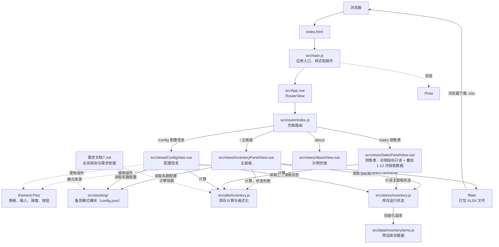
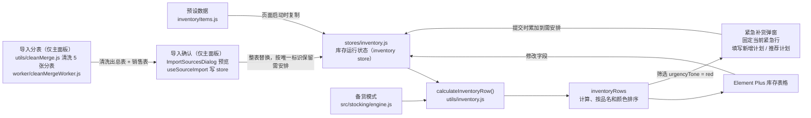

# 布料库存项目架构图

## 1. 应用结构

## 2. 库存数据流

## 3. 阅读代码的推荐顺序

1. [src/main.js](./src/main.js)：应用从这里创建，注册 Vue Router、Pinia，并加载 Element Plus 样式。
2. [src/router/index.js](./src/router/index.js)：`/` 主面板、`/sales` 销售表、`/purchase` 采购下单、`/config` 设置（备货配置 + 下单配置；旧 `/purchase/settings` 自动跳到这里并落到缸规则）、`/hidden` 屏蔽列表。
   顶部导航为共享组件 [src/components/PanelNavigation.vue](./src/components/PanelNavigation.vue)：左侧是主面板组，右侧是屏蔽列表（独立页面，纯文字入口），入口定义在 [src/data/panels.js](./src/data/panels.js)。
3. [src/views/InventoryPanelView.vue](./src/views/InventoryPanelView.vue)：主要业务都在这里，包括表格、编辑、紧急补货计划与「导入分表」。销售表 [src/views/SalesPanelView.vue](./src/views/SalesPanelView.vue) 复用同一份 store 的库存行，并叠加导入的 1-12 月条数与重量；导入入口只有主面板一处：「导入分表」（`useSplitImport` + `ImportSplitTablesDialog`）选 5 张分表 → 清洗出总表 + 销售表 → 由 `useSourceImport` + `ImportSourcesDialog` 预览确认后写入 store。
4. [src/stores/inventory.js](./src/stores/inventory.js)：单一 Pinia store，保存库存、采购清单、撤销状态与销售表；备货配置由 [src/stores/stocking.js](./src/stores/stocking.js) 统一维护。
5. [src/data/inventoryItems.js](./src/data/inventoryItems.js)：页面启动时加载的预设库存记录。
6. [src/stocking/](./src/stocking)：备货模式模块。`config.json` 是唯一配置来源；`fields.js` 登记可用因子字段；`defaults.js` 提供恢复默认；`validate.js` 负责结构校验与模式区间重叠检测；`engine.js` 负责评级 → 模式匹配 → 档位判定 → 系数取用；`persistence.js` 负责读写（开发态由 Vite 插件写回源文件）。
7. [src/data/quantityFields.js](./src/data/quantityFields.js)：唯一标识常量与导入数值字段定义，导入解析与备货因子共用。
10. [src/utils/inventory.js](./src/utils/inventory.js)：把一条原始库存记录和模式转换成在途库存、理论库存、缺口、库存状态等计算结果。
11. [src/utils/xlsxShared.js](./src/utils/xlsxShared.js) + [src/utils/xlsxStream.js](./src/utils/xlsxStream.js)：用 fflate 只解压必要部件读取 .xlsx；`streamSheetRows` 按 4MB 分段解码、逐行回调（出入库明细解压后近 150MB，不能整表转字符串），`readWorkbookRows` 保留整表读取的旧接口（`xlsxSheet.js` 仍可 `import { readWorkbookRows } from '@/utils/xlsxSheet'`）。
12. [src/utils/inventoryImport.js](./src/utils/inventoryImport.js)：导入模板列定义、表头识别、数值/枚举校验与错误行收集。
13. [src/utils/salesImport.js](./src/utils/salesImport.js)：销售表解析（“N月条数 / N月重量”与 4 个动销指标）与按「唯一标识」匹配。
14. [src/utils/sourceImport.js](./src/utils/sourceImport.js)：导入文件角色识别（总表 / 销售表 / 缺少唯一标识）。
15. [src/utils/inventoryApply.js](./src/utils/inventoryApply.js)：总表整表替换库存行、销售表动销指标写回并按备货配置重算。
16. [src/composables/useSourceImport.js](./src/composables/useSourceImport.js)：导入确认与写回（预览 → 写入），分表清洗结果由它打开确认弹窗；总表与销售表必须同时存在。
17. [tools/cleaning/engine.mjs](./tools/cleaning/engine.mjs)：分表清洗的唯一口径（配置 / 唯一标识 / 汇总 / 关联 / 宽松合并），不 import 任何模块；网页经 [src/cleaning/engine.js](./src/cleaning/engine.js)（一行 `export *` 转发）引用它，命令行脚本 [tools/cleaning/clean-merge.js](./tools/cleaning/clean-merge.js) 直接 `import('./engine.mjs')`。[src/utils/cleanMerge.js](./src/utils/cleanMerge.js) 是浏览器侧适配器（fflate 流式读表），[src/utils/splitTableImport.js](./src/utils/splitTableImport.js) + [src/composables/useSplitImport.js](./src/composables/useSplitImport.js) 负责选表、跑 Worker 与接入导入弹窗。
18. [src/data/salesFields.js](./src/data/salesFields.js)：销售表列定义（唯一标识、品名、颜色、4 个动销指标、1-12 月条数与重量）。
19. [docs/需求文档/需求文档1.1.md](./docs/需求文档/需求文档1.1.md)：备货系数、评分判定、库存计算与导入口径的业务依据。
20. [docs/性能优化/主面板大数据量性能优化.md](./docs/性能优化/主面板大数据量性能优化.md)：3 万行量级的性能方案——优化前瓶颈、单行缓存、滚动虚拟化、优化前后实测与后续路线。

## 4. 核心数据如何流动

- 页面初始化时，`src/stores/inventory.js` 为当前面板把 `inventoryItems.js` 中的预设数据复制成独立状态，并按默认评分规格调用 `applyHeatSpecsToItems()` 计算每条记录的评分档。
- `inventoryRows` 根据当前状态调用 `calculateInventoryRow()`，按评分规格名称查系数，计算库存字段和紧急状态，并排序。
- 配置信息页的“评分配置”和“系数配置”共用一份评分规格草稿，点击“确定”后写回 store 并重算全部库存行；新增规格会自动生成对应的系数卡片，配置暂仅保存在运行内存中。
- 表格直接编辑响应式状态；紧急补货弹窗提交时把“新增计划”累加到对应记录的“需安排”。
- 主面板表格为自研虚拟滚动：只渲染视口内的行（视口外按行高偏移占位），行计算走单行缓存 + 增量刷新，编辑一个数值只重算该行与其品名父行，3 万行也不会全量重算。
- 主面板导入入口是「导入分表」：选 5 张分表在 Worker 里清洗出总表 + 销售表，按「唯一标识」解析校验，确认后总表整表替换库存行、销售表叠加 1-12 月条数与重量，并按备货配置重算；需安排、撤销快照和采购清单按「唯一标识」保留。理论库存、预计库存、预警、缺口量、缺口率、库销比仍由 `calculateInventoryRow()` 计算。
- 主面板的“导入分表”直接在页面里做清洗：选 5 张分表（产品资料为基准，其余按唯一标识并入）→ Worker 里流式解析并汇总出总表 + 销售表 → 进同一个导入确认弹窗。清洗口径在 `tools/cleaning/engine.mjs`（网页经 `src/cleaning/engine.js` 转发引用），`tools/cleaning/clean-merge.js` 这个命令行脚本也用它，两处结果已逐格比对一致。
- 响应式状态变化后，`inventoryRows` 重新计算，表格、紧急补货数量与本次采购清单随之更新。
- 本次采购清单导出读取当前的清单行与分订单，在浏览器中生成 XLSX 文件并下载。
- 销售表 `/sales` 读取同一份 store：品名、颜色与库存字段取主面板库存行，1-12 月条数与重量来自 `salesSheet`。导入时由分表清洗出总表 + 销售表：总表整表替换库存行（`applySourceImport`），销售表按「唯一标识」匹配后叠加月份数据，并用其中的动销指标覆盖主面板行、重算评分。

## 5. 当前实现边界

- 库存数据只保存在当前页面运行期间的内存中；没有连接后端、数据库或 `localStorage`。刷新页面会重新从预设数据初始化。
- 库存数据放在单一的 Pinia store（`inventory`）里；`src/stores/counter.js` 是模板计数器示例，不参与库存业务。
- `配置信息` `/config` 仍使用 Element Plus 常规表格；库存记录超过 500 行时按每页 60 行扁平分页渲染，避免大数据量下逐行创建下拉组件。
- `src/components/` 中的 `HelloWorld`、`WelcomeItem` 等是 Vue 模板示例组件，当前库存主流程不依赖它们。
- `src/views/AboutView.vue` 对应 `/about` 示例路由，不影响库存表格。
