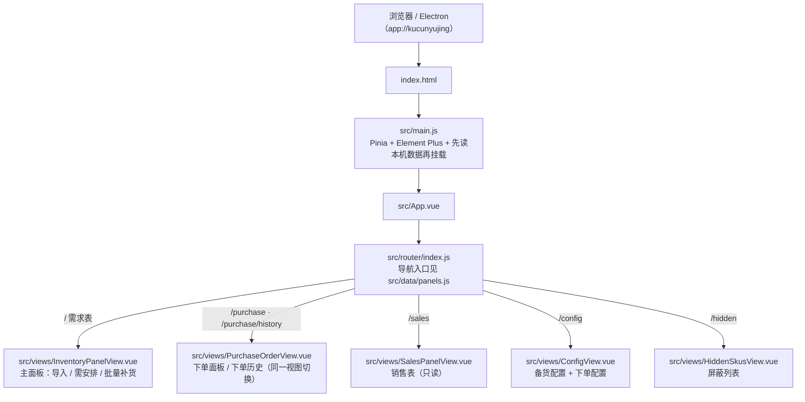
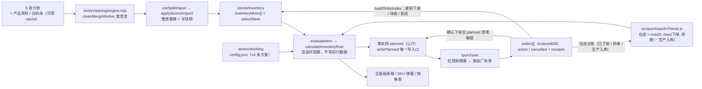

# 项目架构图

> 本文只回答「谁调谁、数据从哪来、存到哪去」。业务口径一律以 [docs/功能说明/](./docs/功能说明/) 下的域文档为准。
> 最后核对：2026-11-25（对应「公斤口径 + IndexedDB 持久化 + 四面板导航」的现状）。

---

## 1. 应用结构

四个业务面板共用同一个 `inventory` store（事实层），各自再叠加自己的视图状态：

| 面板 | 路由 / 导航名 | 视图状态 | 额外配置 |
| --- | --- | --- | --- |
| 主面板 | `/` · 需求表 | `src/stores/inventoryView.js`（筛选 / 展开 / 勾选 / 滚动，只在内存） | `stocking` store |
| 采购下单 | `/purchase` · 采购下单 | 页面内 `selectedKey` / 关键词 | `purchase` store |
| 销售表 | `/sales` · 销售表 | 只读同一份行数据 | — |
| 配置板块 | `/config` · 配置板块 | 草稿（点「确定」才落盘） | `stocking` + `purchase` store |

---

## 2. 数据流

要点：

- **导入只有一个入口**（主面板「导入分表」），清洗完成即写入，没有二次确认弹窗。
- **模式 / 系数 / 评分 / 风险 / 缸都在渲染时按当前配置现算**，改配置立刻全站一致，不需要重新导入。
- **需安排就是待下单列表**：`planned > 0` 的行派生 `/purchase` 的左列表，没有第二份采购清单。
- **订单流水反过来喂库存**：旧口径 `预计库存 = 理论库存 + 累积下单 + 需安排`；每天导入时改用 `在仓 + 在途 + 需安排`（在途由 `src/purchase/inTransit.js` 对账，见 [采购下单流程.md](./docs/功能说明/采购下单流程.md) 3.11）。到货只在「待收 / 到货」之间挪动，不改变预计库存。

---

## 3. 分层与唯一口径

| 层 | 目录 | 负责 |
| --- | --- | --- |
| 清洗 | `tools/cleaning/` | 5 张分表 → 总表 + 销售表；公斤换算；剔除非公斤单位 |
| 解析 / 导入 | `src/utils/` + `src/composables/` | 表头识别、校验、写回 store、写快照 |
| 事实层 | `src/stores/inventory.js` | 行数据 + 销售表 + 需安排 + 撤销快照（只在内存，由 `src/data/` 读写） |
| 口径计算 | `src/stocking/` + `src/utils/inventory.js` | 模式判定、加权月销量、三档库存、预警、评分、风险、SPU、缸 |
| 采购 | `src/purchase/` | 缸规则、选项解析、订单聚合、订单模型归一化、历史导出 |
| 持久化 | `src/data/` | IndexedDB 快照 / 计划层、序列化、启动编排、全量导出导入 |
| 视图 | `src/views/` + `src/components/` | 表格、弹窗、设置块；不自己算业务口径 |

唯一实现（改口径只改这一份）：

| 口径 | 唯一实现 |
| --- | --- |
| 分表清洗 / 单位换算 / 汇总 | `tools/cleaning/engine.mjs` |
| 模式判定 / 系数 / 加权月销量 | `src/stocking/engine.js` |
| 健康度评分（含按量 2 项判定） | `src/stocking/scoring.js` + `src/utils/skuHealth.js` |
| 本次补货风险 | `src/stocking/replenishRisk.js` |
| SPU 分级 | `src/stocking/spuGrades.js` |
| 在途对账（已安排 / 生产中 / 到仓） | `src/purchase/inTransit.js` |
| 缸规则 | `src/purchase/vat.js` |
| 下单填量颜色 | `src/purchase/fillTone.js` |
| 分单选项（染厂 / 分类 / 人员） | `src/purchase/resolve.js` |
| 品名父行聚合 | `src/utils/productGroups.js` |

---

## 4. 持久化

| 层 | 介质 | 内容 |
| --- | --- | --- |
| 事实层 | IndexedDB 快照（gzip，最多 5 份） | `items` + `sales`；**`planned` 被剥成 null**，回滚旧导入不会回滚备货决定 |
| 计划层 | IndexedDB meta `workspace` | `skuId → planned` + 撤销快照，跨导入 / 刷新 / 方案有效 |
| 设置 | localStorage（开发态由 Vite 中间件写回源 JSON） | 备货方案 `config.json` / 手动清单 / 屏蔽清单 / 下单设置 |
| 订单 | IndexedDB（超过 1MB 不再留 localStorage 副本） | `drafts` + `orders[]`（含 `receipts` / `revisions`） |

启动顺序：`src/data/bootstrap.js` 先把订单与快照读回内存，再挂载路由，所以首屏就是「上次的数据」；本机没有数据时退回 `src/data/inventoryItems.js` 的演示种子。

---

## 5. 阅读代码的推荐顺序

1. [src/main.js](./src/main.js)：创建应用、注册 Pinia、先读本机数据再挂载。
2. [src/router/index.js](./src/router/index.js) + [src/data/panels.js](./src/data/panels.js)：路由与导航入口（旧 `/orders`、`/purchase/settings` 只保留跳转）。
3. [src/views/InventoryPanelView.vue](./src/views/InventoryPanelView.vue)：业务主线 —— 导入、筛选、表格、需安排、批量 / 紧急补货。
4. [src/stores/inventory.js](./src/stores/inventory.js)：事实层单一 store（行数据 + 销售表 + 撤销快照）。
5. [src/stocking/](./src/stocking)：`config.json` 是唯一配置来源；`engine.js` 判定与计算入口；`validate.js` 归一化与校验；`defaults.js` 恢复默认。
6. [src/utils/inventory.js](./src/utils/inventory.js)：`calculateInventoryRow()` —— 公斤口径的理论 / 预计库存、三档、缺口、预警、建议需安排。
7. [src/utils/skuHealth.js](./src/utils/skuHealth.js) + [src/stocking/scoring.js](./src/stocking/scoring.js)：评分因子拼装与打分（按量模式走 2 项判定）。
8. [src/purchase/vat.js](./src/purchase/vat.js)：缸规则（skip / ladder / fixed / vat / round）。
9. [src/views/PurchaseOrderView.vue](./src/views/PurchaseOrderView.vue) + [SkuOrderEditor.vue](./src/components/SkuOrderEditor.vue) + [PurchaseOrderRecordsDialog.vue](./src/components/PurchaseOrderRecordsDialog.vue)：拆单、确认下单、到货。
10. [src/data/persistence.js](./src/data/persistence.js) + [serialize.js](./src/data/serialize.js)：快照与计划层的分界。
11. [tools/cleaning/engine.mjs](./tools/cleaning/engine.mjs)：清洗唯一口径（网页经 [src/cleaning/engine.js](./src/cleaning/engine.js) 一行转发，命令行 [clean-merge.js](./tools/cleaning/clean-merge.js) 直接引用）。
12. [tools/check-stocking.mjs](./tools/check-stocking.mjs)：备货口径自检（读当前方案跑样例并断言，改口径后的第一道回归）。

---

## 6. 实现边界

- 业务数据只经 `src/data/` 一层读写，页面与 store 不直连 IndexedDB；设置类仍走 localStorage + 开发态写回 JSON。
- 行 `id` 每次导入都会重排，跨导入一律用 `skuId`（`品名|颜色`）关联需安排、订单、手动清单、屏蔽清单。
- 「删除」是屏蔽（写 `src/stocking/hiddenSkus.json`），源表与销售数据不动，解除在 `/hidden`。
- 演示种子在 [src/data/inventoryItems.js](./src/data/inventoryItems.js)（含 `demoFactorySkuSeeds.json`），只在首次启动 / 清空本机数据后使用。
- `/about`、`HelloWorld`、`TheWelcome` 等是脚手架示例，不参与业务。
- 构建 `base`：线上为 `/kucunyujing/`，桌面离线版（`mode=desktop`）为 `./` 并改用 hash 路由。
