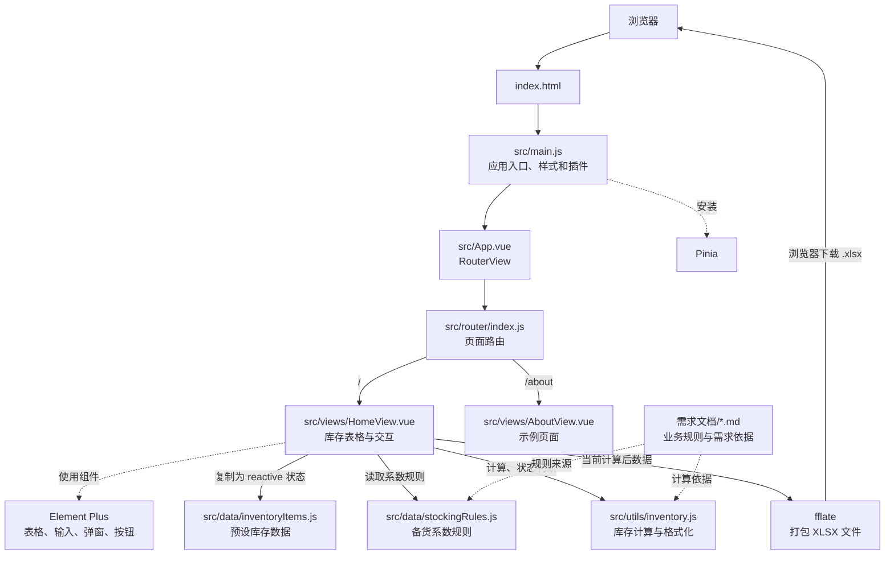
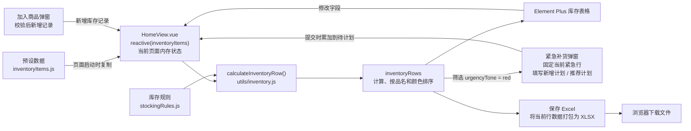

# 布料库存项目架构图

## 1. 应用结构

## 2. 库存数据流

## 3. 阅读代码的推荐顺序

1. [src/main.js](./src/main.js)：应用从这里创建，注册 Vue Router、Pinia，并加载 Element Plus 样式。
2. [src/router/index.js](./src/router/index.js)：`/` 页面指向库存主页面。
3. [src/views/HomeView.vue](./src/views/HomeView.vue)：主要业务都在这里，包括表格、编辑、加入商品、紧急补货计划和 Excel 导出。
4. [src/data/inventoryItems.js](./src/data/inventoryItems.js)：页面启动时加载的示例库存记录。
5. [src/data/stockingRules.js](./src/data/stockingRules.js)：等级、色彩、备货类型到红线/正常/峰值系数的规则表。
6. [src/utils/inventory.js](./src/utils/inventory.js)：把一条原始库存记录和规则转换成预计库存、缺口、库存状态等计算结果。
7. [需求文档/库存规格.md](./需求文档/库存规格.md)：备货系数和库存计算的业务依据。

## 4. 核心数据如何流动

- 页面初始化时，`HomeView.vue` 把 `inventoryItems.js` 中的预设数据复制到 Vue `reactive` 状态。
- `inventoryRows` 根据当前状态调用 `calculateInventoryRow()`，读取 `stockingRules.js`，计算库存字段和紧急状态，并排序。
- 表格直接编辑响应式状态；加入商品会新增记录；紧急补货弹窗提交时把“新增计划”累加到对应记录的“待计划”。
- 响应式状态变化后，`inventoryRows` 重新计算，表格、紧急补货数量和 Excel 导出数据随之更新。
- Excel 导出读取当前的 `inventoryRows`，在浏览器中生成 XLSX 文件并下载。

## 5. 当前实现边界

- 库存数据只保存在当前页面运行期间的内存中；没有连接后端、数据库或 `localStorage`。刷新页面会重新从预设数据初始化。
- Pinia 已在入口安装，但当前库存数据没有放入 Pinia；`src/stores/counter.js` 是模板计数器示例，不参与库存业务。
- `src/components/` 中的 `HelloWorld`、`WelcomeItem` 等是 Vue 模板示例组件，当前库存主流程不依赖它们。
- `src/views/AboutView.vue` 对应 `/about` 示例路由，不影响库存表格。
